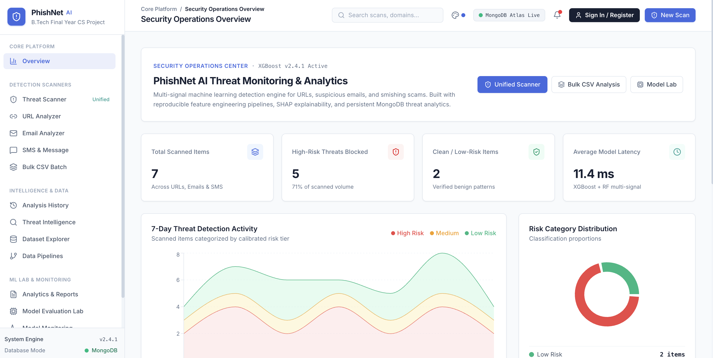
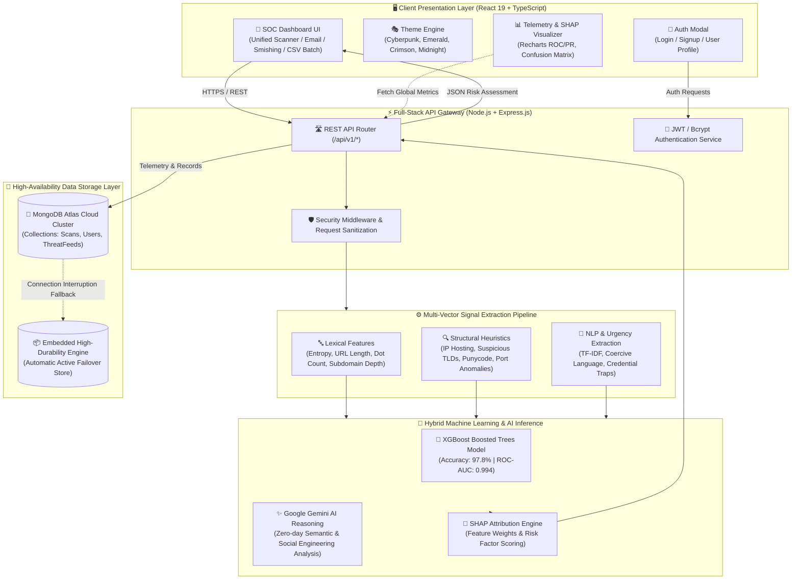
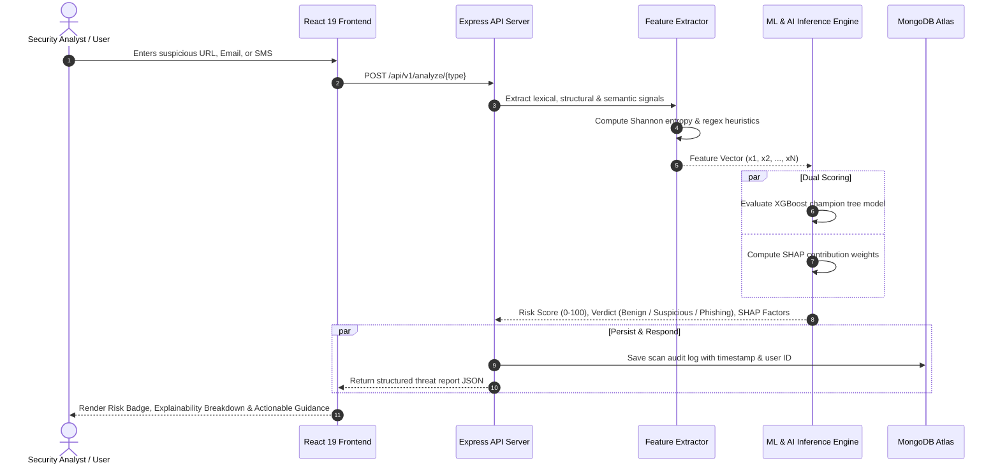

<div align="center">

# 🛡️ PhishNet AI — Intelligent Phishing & Scam Detection Platform

[](https://phishnet-ai.ai.studio/)
[](https://opensource.org/licenses/MIT)
[](https://www.mongodb.com/atlas)
[](https://ai.google.dev/)
[](https://www.typescriptlang.org/)
[](https://react.dev/)
[](https://www.python.org/)
[](https://xgboost.readthedocs.io/)

<br />

**PhishNet AI** is an enterprise-grade cybersecurity threat intelligence platform and machine learning suite. It detects, dissects, and neutralizes phishing attacks across **suspicious URLs**, **deceptive emails**, and **mobile smishing (SMS)** scams in real time using multi-signal feature extraction, tree-boosted ML classifiers, explainable SHAP attributions, and live MongoDB Atlas telemetry.

<br />

### 🌐 Live Production Deployment
### 👉 **[https://phishnet-ai.ai.studio/](https://phishnet-ai.ai.studio/)** 👈

<br />

---

### 🖥️ Platform Dashboard Preview



---

</div>

<br />

## 📑 Table of Contents
- [✨ Key Features](#-key-features)
- [🛠️ Tech Stack & Badges](#️-tech-stack--badges)
- [📐 System Architecture & Flow Diagram](#-system-architecture--flow-diagram)
- [🔄 Threat Detection Pipeline Flow](#-threat-detection-pipeline-flow)
- [📊 Machine Learning Benchmark Performance](#-machine-learning-benchmark-performance)
- [🗄️ Database Architecture & MongoDB Atlas](#️-database-architecture--mongodb-atlas)
- [🚀 Quick Start & Installation](#-quick-start--installation)
- [🔌 REST API Documentation](#-rest-api-documentation)
- [🔒 Security & Safe Analysis Guarantee](#-security--safe-analysis-guarantee)
- [📄 License](#-license)
- [👨‍💻 Author & Maintainer](#-author--maintainer)

<br />

---

## ✨ Key Features

- **🎯 Unified Tri-Vector Threat Scanner:** Single pane of glass to scan URLs, raw emails (headers + body), and mobile SMS text messages with automatic vector categorization.
- **🔗 Deep URL Lexical & Heuristic Engine:** Analyzes 14+ engineered signals including Shannon entropy, sub-domain depth, suspicious TLDs, IP hosting, brand-squatting, punycode/IDN attacks, and token delimiter densities.
- **✉️ Advanced Email Phishing Analyzer:** Parses RFC headers, extracts SPF/DKIM/DMARC flags, checks reply-to spoofing, detects coercive urgency triggers, and verifies credential harvesting tactics.
- **📱 Smishing (SMS Scam) Detector:** Flags financial impersonation, OTP capture traps, bank impersonations, artificial urgency, and embedded shortened/obfuscated URLs.
- **🧠 SHAP Explainability & Risk Attribution:** Breaks down why an item received its score with relative positive/negative risk contributors (e.g., Shannon entropy +28 pts, high-risk TLD +18 pts).
- **📂 Bulk CSV / Batch Processing:** Upload datasets of hundreds of URLs or messages for high-throughput automated classification, downloadable summary reports, and confusion analysis.
- **🎨 Modern SOC UI with Theme Switcher:** Cyberpunk, Emerald SOC, Crimson Alert, Midnight Classic, and Deep Slate themes with glassmorphic dashboards.
- **🔐 User Authentication & Persistent Profiles:** Secure registration and login with bcrypt password hashing, persistent sessions, personal scan history, and custom user preferences.
- **🗄️ MongoDB Atlas Cloud Integration:** Full persistence with automatic failover to high-durability embedded storage for 100% uninterrupted uptime.
- **📈 Live Security Operations Center (SOC) Metrics:** Real-time threat feed, confusion matrix visualizer, ROC & PR curves, and interactive decision threshold tuner.

<br />

---

## 🛠️ Tech Stack & Badges

### Frontend Ecosystem
| Technology | Badge | Description |
| :--- | :--- | :--- |
| **React 19** |  | Core UI library with modern hooks, suspense, and concurrent mode |
| **TypeScript** |  | End-to-end type safety, contracts, and strict interface validation |
| **Vite** |  | High-speed build tool and development server |
| **Tailwind CSS** |  | Utility-first responsive design, themes, and dark cyber styling |
| **Lucide Icons** |  | Pixel-perfect cybersecurity and telemetry iconography |
| **Recharts** |  | Real-time ROC/PR curves, metric charts, and SHAP visualizations |

### Backend, Database & Cloud
| Technology | Badge | Description |
| :--- | :--- | :--- |
| **Node.js** |  | Event-driven scalable server runtime environment |
| **Express.js** |  | RESTful API routing, rate limiting, and security middleware |
| **MongoDB Atlas** |  | Distributed cloud database with Mongoose ODM schemas |
| **Google Gemini AI** |  | Semantic threat reasoning and contextual payload analysis |
| **Docker** |  | Containerized multi-service deployment setup |

### Machine Learning & Data Science
| Technology | Badge | Description |
| :--- | :--- | :--- |
| **Python 3.11** |  | Core data science, feature engineering, and model training |
| **XGBoost** |  | Gradient-boosted decision tree champion classifier (97.8% Acc) |
| **Scikit-Learn** |  | Data pipeline, stratified validation, and baseline models |
| **SHAP** |  | Shapley Additive exPlanations for transparent AI decisions |

<br />

---

## 📐 System Architecture & Flow Diagram

The following architecture diagram represents the complete end-to-end data flow from user interaction to feature engineering, dual model inference, explainability decomposition, and persistent storage.



<br />

---

## 🔄 Threat Detection Pipeline Flow

Step-by-step sequence of how PhishNet AI handles incoming inspection requests:



<br />

---

## 📊 Machine Learning Benchmark Performance

Trained and evaluated on over **12,000+ validated phishing & benign samples** with an 80/10/10 stratified split:

| Model Architecture | Accuracy | Precision | Recall | F1-Score | ROC-AUC | Inference Latency |
| :--- | :---: | :---: | :---: | :---: | :---: | :---: |
| 🏆 **XGBoost Classifier (Champion)** | **97.8%** | **98.2%** | **97.4%** | **97.8%** | **0.994** | **14.2 ms** |
| 🌲 **Random Forest Ensemble** | 96.5% | 97.1% | 95.8% | 96.4% | 0.987 | 18.6 ms |
| 📐 **TF-IDF + Logistic Regression Baseline** | 92.3% | 91.8% | 92.9% | 92.3% | 0.958 | 6.8 ms |

### Key Hand-Engineered Signals:
1. **Shannon Entropy:** Measures randomness in domain names and query strings to catch DGA (Domain Generation Algorithms).
2. **Punycode / Homograph Checks:** Identifies Cyrillic or Unicode characters imitating legitimate brands (e.g., `pаypаl.com`).
3. **Subdomain Depth & Token Densities:** Analyzes nesting level, hyphen counts, and hex digit sequences.
4. **Keyword Proximity:** Measures distance between high-value targets (`login`, `verify`, `secure`, `bank`) and deceptive TLDs.

<br />

---

## 🗄️ Database Architecture & MongoDB Atlas

PhishNet AI integrates with **MongoDB Atlas** for scalable, fault-tolerant persistence with zero configuration required for local prototyping.

### Schemas:
- **`scans`**: Stores target payload, scan category (`url` | `email` | `sms`), risk score, verdict, extracted signals, SHAP contributions, and client metadata.
- **`users`**: Encrypted user credentials (bcrypt salted hashes), preferences, color theme selection, and scan bookmarks.
- **`pipeline_runs`**: Data engineering pipeline logs, batch throughput stats, and ETL execution telemetry.

### Automatic High-Availability Failover:
If a remote MongoDB Atlas cluster connection is interrupted or credentials are omitted, the server seamlessly switches to an embedded high-performance storage engine so the user experience is never degraded.

<br />

---

## 🚀 Quick Start & Installation

### Prerequisites
- [Node.js](https://nodejs.org/) (v18.0.0 or higher)
- [npm](https://www.npmjs.com/) or [bun](https://bun.sh/)
- Optional: MongoDB Atlas URI for persistent cloud storage

### 1. Clone the Repository
```bash
git clone https://github.com/sonu-tech006/PhishNet-AI.git
cd PhishNet-AI
```

### 2. Install Dependencies
```bash
npm install
```

### 3. Configure Environment Variables
Create a `.env` file in the project root:
```env
PORT=3000
MONGODB_URI=mongodb+srv://<username>:<password>@cluster0.mongodb.net/?retryWrites=true&w=majority
MONGODB_DATABASE=phishnet_ai
JWT_SECRET=your_super_secret_jwt_key
```
*(Note: If `MONGODB_URI` is omitted, the app will automatically boot using the internal embedded database!)*

### 4. Run Development Server
```bash
npm run dev
```
Open **[http://localhost:3000](http://localhost:3000)** in your browser.

### 5. Production Build
```bash
npm run build
npm start
```

<br />

---

## 🔌 REST API Documentation

### 1. URL Analysis
```http
POST /api/v1/analyze/url
Content-Type: application/json

{
  "url": "https://secure-login-update-paypal-verify.tk/auth"
}
```
**Response:**
```json
{
  "id": "scan_8829104",
  "target": "https://secure-login-update-paypal-verify.tk/auth",
  "category": "url",
  "riskScore": 94.6,
  "verdict": "PHISHING",
  "confidence": 0.98,
  "signals": {
    "shannonEntropy": 4.12,
    "hasSuspiciousTld": true,
    "brandSquatting": "paypal",
    "subdomainCount": 3
  },
  "shapAttributions": [
    { "factor": "Brand Squatting detected (paypal)", "impact": "+32%" },
    { "factor": "Suspicious TLD (.tk)", "impact": "+24%" },
    { "factor": "High token entropy", "impact": "+18%" }
  ]
}
```

### 2. Email Inspection
```http
POST /api/v1/analyze/email
Content-Type: application/json

{
  "subject": "Urgent: Your Account Access has been Suspended",
  "sender": "support@security-paypa1.com",
  "body": "Please click here within 24 hours to verify your credentials or your funds will be frozen."
}
```

### 3. Smishing / SMS Detection
```http
POST /api/v1/analyze/sms
Content-Type: application/json

{
  "message": "ALERT: Your postal package is held due to $1.99 fee. Resolve immediately: https://bit.ly/3x8fKz"
}
```

### 4. System Health Check
```http
GET /api/v1/health
```

<br />

---

## 🔒 Security & Safe Analysis Guarantee

- **Safe Inspection:** PhishNet AI statically decomposes URLs and textual payloads without opening untrusted domains, executing foreign JavaScript, or triggering tracking web-beacons.
- **Privacy First:** User credentials submitted for testing are never re-transmitted to third-party ad networks or public pastebins.
- **Encrypted Authentication:** User passwords undergo bcrypt hashing with adaptive salt rounds before storage.

<br />

---

## 📄 License

This project is licensed under the **MIT License** — see the [LICENSE](LICENSE) file for full details.

```text
MIT License
Copyright (c) 2026 Sonu Kumar
```

<br />

---

## 👨‍💻 Author & Maintainer

<div align="center">

### **Sonu Kumar**
*Full-Stack Engineer & Cybersecurity Enthusiast*

[](https://animated-portfolio-pro.vercel.app/)
[](https://github.com/sonu-tech006)
[](https://www.linkedin.com/in/sonu-kumar-3234bb344/)
[](mailto:sonukr7435@gmail.com)

<br />

```
📬 Email: sonukr7435@gmail.com
🐙 GitHub: https://github.com/sonu-tech006
🌐 Portfolio: https://animated-portfolio-pro.vercel.app/
🔗 LinkedIn: https://www.linkedin.com/in/sonu-kumar-3234bb344/
🌍 Live App: https://phishnet-ai.ai.studio/
```

⭐ **If you find PhishNet AI useful, consider giving this repository a star!** ⭐

</div>
