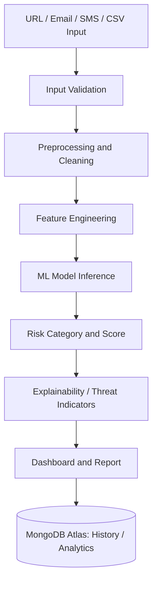
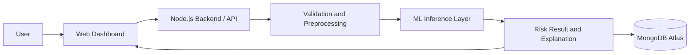

::: {align="center"}
# 🛡️ PhishNet AI

### AI-Powered Phishing & Scam Detection Platform

**Detect suspicious URLs, phishing emails, and scam messages with a
unified threat-analysis dashboard.**

:::📸 Project Preview

Security operations dashboard showing scan activity, risk distribution,
model latency, and threat-monitoring controls.
🎯 Overview
PhishNet AI is a machine-learning-oriented cybersecurity analytics
project for investigating potentially harmful digital content. It brings
URL analysis, email analysis, SMS/message scanning, and bulk CSV
analysis together in one interface. A central dashboard presents scan
counts, risk categories, activity trends, and model-related analytics.

The project focuses on combining input preprocessing, feature
engineering, machine-learning classification, risk categorization,
explainability, and persistent analytics into a single
threat-monitoring workflow.
Important: Model names and capabilities below reflect the project
dashboard and intended pipeline. Verify the repository's actual
training/inference code before describing any component as fully
implemented or reporting model-performance metrics.

✨ Key Features
- Unified Threat Scanner --- central entry point for supported
  threat-analysis workflows.
- URL Analyzer --- investigate suspicious URLs and URL-related
  indicators.
- Email Analyzer --- analyze potentially deceptive or malicious
  email content.
- SMS & Message Analyzer --- assess suspicious texts and scam
  patterns.
- Bulk CSV Analysis --- submit structured records for batch
  analysis.
- Risk Classification --- group findings into high-, medium-, and
  low-risk categories.
- Threat Monitoring Dashboard --- summarize scans, risk
  distribution, and recent activity.
- Analysis History --- organize previous scan results.
- Threat Intelligence & Dataset Explorer --- provide views for
  investigation and data inspection.
- Model Lab & Analytics --- support model-oriented evaluation and
  reporting workflows.
- Explainability-oriented results --- use interpretable indicators
  to help reviewers understand why content may be suspicious.
🧰 Technology Stack --- ML & Cybersecurity Details
Core machine-learning stack
  Technology                                                                                           Role in the project
  {=html} Python   Common language for data
                                                                                                       processing, feature engineering,
                                                                                                       model training, and ML inference
                                                                                                       services where the ML pipeline is
                                                                                                       Python-based.

  {=html}            Gradient-boosted decision-tree
  XGBoost                                                                                          model referenced by the dashboard
                                                                                                       for classifying suspicious patterns
                                                                                                       from engineered features.

  {=html}   Useful for preprocessing utilities,
  scikit-learn                                                                                     train/test splitting, baselines,
                                                                                                       evaluation metrics, and
                                                                                                       model-comparison workflows. Confirm
                                                                                                       which parts are used in the source
                                                                                                       code.

  Random Forest                                                                                    Tree-ensemble model referenced by
                                                                                                       the dashboard as part of its
                                                                                                       multi-signal detection approach.

  Feature Engineering                                                                              Converts raw URLs, message text,
                                                                                                       and structured records into
                                                                                                       measurable signals suitable for
                                                                                                       classification. The exact features
                                                                                                       depend on the implemented pipeline.

  SHAP                                                                                             Explainability method referenced by
                                                                                                       the dashboard; can help show which
                                                                                                       features contributed to an
                                                                                                       individual prediction when
                                                                                                   integrated with the model.
Data & feature engineering
  Area                                What it means for phishing
                                      detection
  URL features                    Potential features include URL
                                      length, number of subdomains,
                                      unusual symbols, IP-address usage,
                                      HTTPS indicators, and suspicious
                                      token patterns---only include those
                                      actually implemented in your code.

  Email/message features          Potential signals include urgency
                                      language, suspicious links,
                                      requests for credentials, and
                                      scam-related text patterns. NLP
                                      features depend on the implemented
                                      text-processing method.

  Data validation                 Check missing values, unexpected
                                      columns, invalid records, and
                                      inconsistent input formats before
                                      analysis.

  Normalization / preprocessing   Clean and standardize inputs so the
                                      model receives data in the format
                                      expected during training.

  Batch processing                CSV workflows can support analyzing
                                      multiple records consistently,
                                      subject to the implemented schema
                                  and validation rules.
Application, storage & visualization
  Technology / component                                                                      Purpose
  Node.js                                                                                 Backend runtime identified for the
                                                                                              application setup; may handle
                                                                                              application APIs and coordinate
                                                                                              dashboard requests.

  {=html}   Cloud database indicated by the
  MongoDB Atlas                                                                           dashboard for storing application
                                                                                              data such as scan records, history,
                                                                                              or analytics, depending on the
                                                                                              implemented schema.

  Web dashboard                                                                           User interface for scanners, model
                                                                                              tools, monitoring metrics, and risk
                                                                                              distribution charts.

  Mermaid                                                                                 Renders the architecture and
                                                                                              workflow diagrams included in this
                                                                                              README.

  Google AI Studio                                                                        Published live-demo environment
                                                                                          linked above.
Stack accuracy note: The screenshot identifies Node.js, MongoDB
Atlas, XGBoost, Random Forest, and SHAP-related functionality. The
detailed Python/scikit-learn and feature examples above describe
typical roles in an ML pipeline, not proof that every library or
feature is already present in your repository. Remove any technology
badge or row that your source code does not actually use.

🔄 Machine Learning Workflow

What each stage does
1. Input: The user submits a URL, email, text message, or supported
   CSV data.
2. Validation: The application checks whether the input is
   acceptable for the selected scanner.
3. Preprocessing: Inputs are cleaned and transformed into a
   consistent representation.
4. Feature engineering: Useful signals are extracted from the
   input. URL, text, and tabular inputs generally need different
   feature pipelines.
5. Model inference: A trained classifier, such as XGBoost or Random
   Forest where configured, predicts a class or risk level.
6. Risk interpretation: The prediction is mapped to a user-facing
   category such as high, medium, or low risk.
7. Explainability: SHAP or other explanation methods can identify
   influential features if implemented in the inference path.
8. Persistence and reporting: Results may be saved and summarized
   in the dashboard according to the application's database schema.
🏗️ High-Level Architecture

This is a high-level documentation diagram. Update it if your actual
repository uses a different service layout or model-serving mechanism.
📊 Model Evaluation --- Recommended Metrics
For a phishing detector, accuracy alone can be misleading because benign
and malicious samples may be imbalanced. Consider reporting these
metrics once you have measured them on a held-out test set:
- Precision: Of the items flagged as phishing, how many were
  actually phishing?
- Recall: Of all phishing items, how many did the model detect?
- F1-score: A balance between precision and recall.
- Confusion matrix: Shows true positives, false positives, true
  negatives, and false negatives.
- False-positive rate: Important because incorrectly flagging
  legitimate messages can reduce trust.
- Inference latency: Measures how long a scan takes under a
  defined test setup.
No accuracy, precision, or recall value is claimed in this README
because a verified evaluation report was not provided.
🚀 Live Demo
::: {align="center"}

**<https://phishnet-ai.ai.studio/>**
:::Explore the dashboard and available scanner sections. Do not enter real
passwords, private messages, API keys, or other sensitive information
into a demo.
💻 Run Locally
Clone the repository:
git clone https://github.com/sonu-tech006/PhishNet-AI.git
cd PhishNet-AI
Replace PhishNet-AI with the exact repository name if it differs.

Install dependencies using the scripts defined in the repository. For a
Node.js project, the commands may look like:
npm install
npm run dev
If the project has separate frontend and backend directories, install
and start each service using its own package.json. Configure
environment variables in a local .env file. Never commit API keys,
database credentials, or other secrets. Check the actual scripts and
deployment setup before running these commands.
🔐 Security & Responsible Use
- Treat the scanner as a decision-support tool, not a guarantee that
  content is safe or malicious.
- Verify suspicious findings through trusted security procedures.
- Do not use real credentials or sensitive personal data for testing.
- Keep database credentials, API keys, and other secrets in
  environment variables.
- Use authorized datasets and only test URLs or systems you are
  permitted to analyze.
🛣️ Future Improvements
- Publish measured precision, recall, F1-score, and confusion-matrix
  results.
- Add model versioning, reproducible training scripts, and dataset
  documentation.
- Add downloadable investigation reports and per-feature explanations.
- Add automated tests for APIs, preprocessing, and data pipelines.
- Improve drift monitoring and false-positive review workflows.
- Document environment variables and exact deployment steps.
👨‍💻 Author
Sonu Kumar
B.Tech Computer Science & Engineering
- Email: sonukr7435@gmail.com
- GitHub: sonu-tech006
- Portfolio:
  animated-portfolio-pro.vercel.app
- Live Project: PhishNet AI
::: {align="center"}
**Built with curiosity for AI, machine learning, and cybersecurity.**
:::
